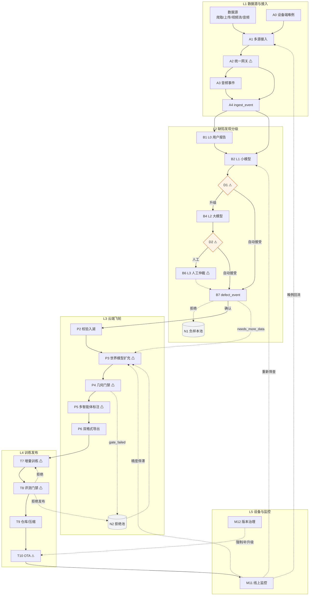
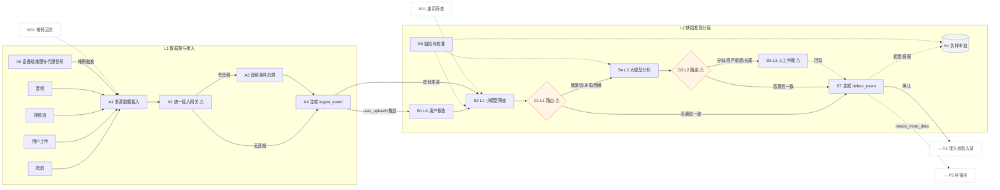
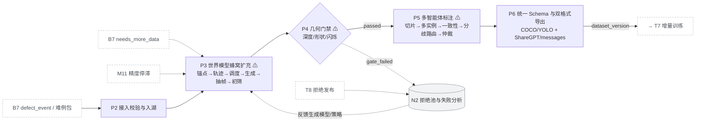
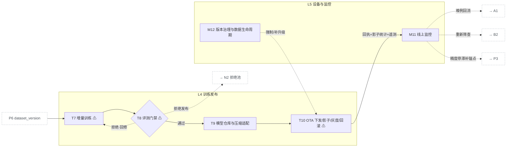
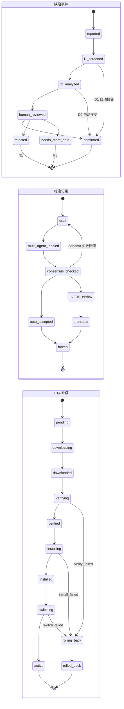
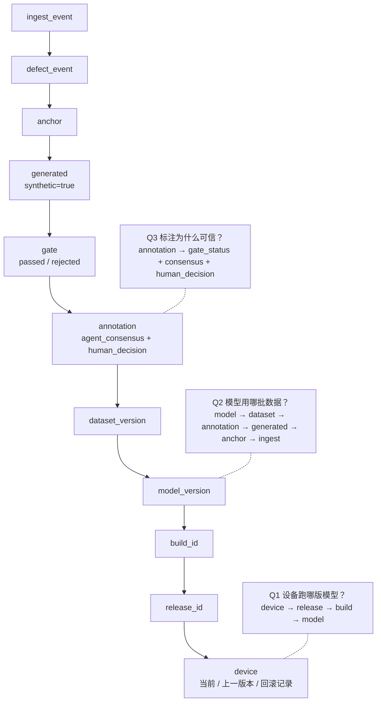

# 系统处理流程文档（流程图设计稿）

| 项 | 内容 |
| --- | --- |
| 版本 | v0.2 |
| 用途 | 端到端框架流程图、泳道图、状态机图的设计依据 |
| 配套图文件 | `docs/diagrams/dataota-framework.drawio`（7 页，可在 draw.io / diagrams.net / VS Code Draw.io 插件中直接编辑） |
| 预览图 | `docs/diagrams/png/*.png`（由 draw.io 文件导出的预览；改图后可用 `docs/diagrams/tools/` 下脚本重新生成） |

**画图原则**

1. 节点标签短，详细处理放本文表格或图中 tooltip（draw.io 中鼠标悬停节点可看处理要点 / 异常降级）。
2. 主流程实线；回流、降级、补样、仲裁回写用灰色虚线；异常 / 失败 / 拒绝用红色虚线。
3. Demo 与生产用角标区分：蓝色 **D** = Demo 实现，橙色 **P** = 生产设计（悬停角标可看具体方案）。
4. 未定项在图中用 **⚠** 占位，清单见第 8 节。

---

## 1. 图清单

| 图 | 内容 | 优先级 | draw.io 页 | 预览 |
| --- | --- | --- | --- | --- |
| 图 1 | 五层总览主流程（一页全景泳道） | 必画 | 图1 五层总览 | fig1-overview.png |
| 图 2 | 入口层 + 缺陷发现分级泳道 | 必画 | 图2 入口+发现 | fig2-ingest-discovery.png |
| 图 3 | 云端飞轮泳道（P2–P6） | 必画 | 图3 云端飞轮 | fig3-cloud-flywheel.png |
| 图 4 | 训练发布 + 线上闭环泳道 | 必画 | 图4 训练发布+闭环 | fig4-train-release-loop.png |
| 图 5 | 三类状态机小图 | 建议 | 图5 状态机 | fig5-state-machines.png |
| 图 6 | 版本血缘主线 | 建议 | 图6 版本血缘 | fig6-lineage.png |
| 附 | 图例 + Demo/生产 + 不做清单 + ⚠ 待定项 | — | 附 图例与待定项 | appendix-legend.png |

---

## 2. 泳道划分与图例

### 2.1 泳道

| 泳道 | 包含节点 | 说明 |
| --- | --- | --- |
| **L1 数据源与接入** | 数据源、A0–A4 | 爬取、上传、视频流、音频、设备回流 → 统一网关 → `ingest_event` |
| **L2 缺陷发现分级** | B1、B2、D1、B4、D2、B6、B7、B8、N1 | L0→L1→L2→L3 逐级升级，路由决策，负样本池 |
| **L3 云端飞轮** | P2–P6、N2 | 接入校验、世界模型扩充、几何门禁、多智能体标注、双格式导出 |
| **L4 训练发布** | T7–T10 | 增量训练、评测门禁、模型仓库、OTA |
| **L5 设备与监控** | M11、M12 | 遥测、漂移、精度停滞触发、版本治理 |
| **横切带** | C1–C5 | 血缘、隐私、算力成本、审计、指标字典 |

> 编号说明：发现层的 B3、B5 位置由路由菱形 D1、D2 占用，故 B 系列编号不连续，属有意为之。

### 2.2 图例

| 符号 | 含义 |
| --- | --- |
| 实线箭头 | 主流程 |
| 灰色虚线箭头 | 回流、降级、补样、人工仲裁后回写 |
| 红色虚线箭头 | 异常 / 失败 / 拒绝分支 |
| 菱形 | 路由决策（D1、D2）或门禁决策（P4、T8 旁） |
| 圆柱 | 样本池 / 拒绝池（N1、N2） |
| 蓝色角标 **D** | Demo 阶段实现方式 |
| 橙色角标 **P** | 生产阶段设计方式 |
| ⚠ | 待定项，图中保留占位 |

---

## 3. 主流程节点清单

### 3.1 入口层：多源数据接入（L1）

| ID | 节点标签 | 输入 | 处理要点 | 输出 | 异常 / 降级 | Demo / 生产 |
| --- | --- | --- | --- | --- | --- | --- |
| A0 | 设备端推理与代理信号 | 推理结果、置信度、影子输出 | 低置信 / 分歧 / 场景异常 / 下游纠正触发难例 | 难例候选 | 影子崩溃不影响主推理 | D：离线回放；P：真实设备 |
| A1 | 多源数据接入 | 爬取、用户上传、视频流、音频、设备回流 | 认证、转码、元数据、来源标记 | 原始数据包 | 版权不明隔离；流断流记录 | D：本地目录 + 一段离线流；P：接入网关 |
| A2 | 统一接入网关 ⚠ | 原始数据包 | 标准化、合规脱敏、去重、元数据补全 | 标准化媒体 | 隐私不合规先脱敏 / 隔离 | D：脚本；P：转码集群 |
| A3 | 音频事件处理 | 带音频媒体 | ASR、声音事件分类、时间戳对齐、紧急度 | `audio_events[]` | 质量差只保留事件分类 | D：单段音频；P：音频管线 |
| A4 | 生成 ingest_event | 标准化媒体 + 音频事件 + 描述 | 封装统一接入事件 | `ingest_event` | Schema 校验失败退回 | 通用 |

**`ingest_event` 关键字段**：`ingest_id`、`source_type`、`media`、`user_description`、`audio_events[]`、`privacy_flag`、`dedup_hash`、`source_meta`。

### 3.2 发现层：缺陷发现与分级（L2）

| ID | 节点标签 | 输入 | 处理要点 | 输出 | 异常 / 降级 | Demo / 生产 |
| --- | --- | --- | --- | --- | --- | --- |
| B1 | L0 用户报告 | 用户上传媒体 + 描述 | 解析缺陷类型 / 位置 / 主观严重度 | `user_claim` | 恶意报告标记 | D：手工构造；P：上传接口 + 解析 |
| B2 | L1 小模型筛查 | `ingest_event` | 快速检测疑似缺陷、类别、粗位置 | `l1_result` | 不可用则跳 L2 并记录 | D：YOLO / RT-DETR；P：多任务小模型 |
| D1 | L1 路由决策 ⚠ | `l1_result` + `user_claim` + 音频 | 高置信且一致 → 自动接受；否则升级 | 路由结果 | 规则可配置 | D：脚本阈值；P：规则引擎 |
| B4 | L2 大模型分析 | 媒体 + 描述 + L1 + 音频 | 判定真实性、类型、严重度、证据、reasoning | `l2_result` | 成本超限按优先级排队 | D：Qwen2.5-VL-3B；P：大模型集群 |
| D2 | L2 路由决策 ⚠ | `l2_result` + L1 + 历史 | 高置信一致 → 自动接受；困难 / 高严重度 → 人工 | 路由结果 | 抽检命中也升级 | D：规则；P：在线校准 + AB |
| B6 | L3 人工仲裁 ⚠ | 全部上下文 + L1/L2 | 最终裁决、修正标注、仲裁理由、人工分钟 | `human_decision` | 积压按严重度 + 分歧度排序 | D：本地审核台 10–20 条；P：审核平台 |
| B7 | 生成 defect_event | 各级结果 + 路由轨迹 | 封装缺陷事件与证据 | `defect_event` | 需更多数据 → 触发补锚点 | 通用 |
| B8 | 抽检与校准 | 自动接受样本、误报样本 | 高一致样本抽检、L1/L2 校准 | 校准记录 | 发现共谋错误 → 回修 | D：人工抽检；P：持续校准 |
| N1 | 负样本池 | 拒绝 / 误报 / 无效报告 | 用于 L1/L2 校准和负样本训练 | 负样本 | 定期清理 | 通用 |

**`defect_event` 关键字段**：`defect_id`、`level_reached`、`defect_type`、`location`、`severity`、`confidence`、`evidence`（帧 / 片段 / 音频 / L1/L2 reasoning）、`routing_trace`、`human_decision`、`final_decision`。

**升级规则**

| 升级 | 触发条件（任一满足） |
| --- | --- |
| L1 → L2（D1） | 低置信；类别不确定；用户描述与 L1 矛盾；音频异常但视觉未检出；困难切片 |
| L2 → L3（D2） | L1/L2 分歧；L2 低置信或自评不确定；高严重度；长尾新场景；抽检命中 |

### 3.3 生产层：云端飞轮（L3）

| ID | 节点标签 | 输入 | 处理要点 | 输出 | 异常 / 降级 | Demo / 生产 |
| --- | --- | --- | --- | --- | --- | --- |
| P2 | 接入校验与入湖 | `defect_event` / 难例包 | 认证、Schema 校验、幂等去重、隐私复核、入湖 | 标准化记录 + 队列任务 | 校验失败隔离 | D：脚本入目录；P：对象存储 + 队列 |
| P3 | 世界模型蜂窝扩充 ⚠ | 锚点 / 难例、场景标签、缺失视角 | 锚点选择 → 轨迹生成 → 算力调度 → 视频生成 → 抽帧 → lineage → 初筛 | 生成帧 / 片段 + lineage | 可用率低收窄视角 / 换模型 | D：PPMem / InSpatio / 受控变换；P：Holo4D / DreamX / SANA-WM |
| P4 | 几何门禁 ⚠ | 生成帧 / 片段 | 深度连续性、形状稳定性、纹理闪烁；可选 PDI-Bench；加权评分 | `gate_score` / `gate_status` | 与人工不一致调阈值；通过率低回 P3 | D：三项自洽 + 20 段抽检；P：标准化审计 |
| P5 | 多智能体标注与分歧路由 ⚠ | 通过门禁的帧段 | 视角切片分配 → 多实例标注 → 交叉一致性 → 分歧路由 → 人工仲裁 → 语义生成 | 统一 schema 标注 | 分歧率过高换配置 / 降级 | D：2–3 实例 + 本地审核台；P：多智能体集群 |
| P6 | 统一 Schema 与双格式导出 | 标注记录 | Schema 校验 → 落库 → COCO/YOLO → ShareGPT/messages → 数据集版本化 → 血缘 | `dataset_version` | 坐标越界回修；导出器回归测试 | D：四导出器 + 小样本；P：版本管理 + 审计 |
| N2 | 拒绝池与失败分析 | 门禁拒绝帧段、共谋错误案例、T8 拒绝发布 | 失败归因、反馈生成模型 / 标注策略 | 失败分析报告 | 定期复盘 | 通用 |

**`dataset_version` 关键字段**：`dataset_version`、`format`、`export_config`、`sample_list`、`schema_version`、`exporter_version`、`lineage`。

**硬约束**

1. 合成数据只进训练集，不进评测集。
2. 门禁通过才进标注。
3. 分歧和人工仲裁记录保留，作为 VLM 高价值信号。
4. 同一份标注事实派生两种格式（检测格式 COCO/YOLO + 对话格式 ShareGPT/messages）。

### 3.4 训练发布层（L4）

| ID | 节点标签 | 输入 | 处理要点 | 输出 | 异常 / 降级 | Demo / 生产 |
| --- | --- | --- | --- | --- | --- | --- |
| T7 | 增量训练 ⚠ | `dataset_version`、真实留出集、基线 | 数据配比、难例加权、训练、成本记录 | 候选模型 + 训练血缘 | 不收敛回退基线；成本超限缩规模 | D：小模型三轮对比；P：大模型微调 + 分布式 |
| T8 | 评测门禁 ⚠ | 候选模型、真实设备金标回归集 | 分切片评测、不退化门禁、污染检查、代理指标对齐 | 评测报告 + 发布计划 | 某切片退化拒绝发布 | D：小规模真实留出集；P：金标回归 + 统计显著性 |
| T9 | 模型仓库与压缩适配 | 签名模型、硬件清单 | 仓库登记、量化编译、manifest、差分 | 模型包 + manifest + 发布指令 | 编译失败该硬件不发布 | D：manifest + 脚本模拟；P：多硬件编译 + CDN |
| T10 | OTA 下发 / 影子 / 灰度 / 回滚 ⚠ | 发布指令、模型包、设备清单 | 下载 → 校验 → 安装 → 切换 → 影子 → 灰度 → 回滚 → 回执 | 升级回执 + 影子统计 | 失败自动回滚，保留旧版 | D：状态机模拟 + 离线回放；P：真实双分区 + 灰度平台 |

**发布单（T8 输出）关键字段**：`release_id`、`model_version`、`eval_slices`、`regression_threshold`、`rollout_plan`、`rollback_threshold`、`signature`。

### 3.5 闭环层：线上监控（L5）

| ID | 节点标签 | 输入 | 处理要点 | 输出 | 异常 / 降级 | Demo / 生产 |
| --- | --- | --- | --- | --- | --- | --- |
| M11 | 线上监控 | 设备遥测、回执、影子统计 | 延迟 / 内存 / 置信度分布 / 难例率 / 版本分布 / 回滚率；漂移检测；精度停滞触发 | 告警 + 补样任务 + 难例回流 | 遥测丢失本地补报；漂移误报用金标确认 | D：脚本统计；P：实时遥测平台 |
| M12 | 版本治理与数据生命周期 | 版本分布、保留期限 | 最低支持版本、强制升级、离线补升级、EOL、过期删除 | 治理决策 + 删除审计 | 碎片过高启动补升级 | D：文档设计；P：治理平台 |

**回流路径**

| 起点 | 终点 | 含义 |
| --- | --- | --- |
| M11 | A1 | 难例回流 |
| M11 | B2 | 重新筛查 |
| M11 | P3 | 精度停滞，补锚点 |
| M12 | T10 | 强制升级 / 离线补升级 |

### 3.6 横切能力

| ID | 横切项 | 贯穿 | 图中表现 |
| --- | --- | --- | --- |
| C1 | 版本血缘 | 全流程 | 右侧竖向色带：`ingest → defect → anchor → generated → gate → annotation → dataset → model → build → release → device` |
| C2 | 隐私合规 ⚠ | A2、P2、P6、M12 | 脱敏 / 隔离 / 保留期限 |
| C3 | 算力调度与成本 ⚠ | P3、P5、T7、T9 | 预算 / 队列 / 优先级 |
| C4 | 审计日志 | 全流程 | 门禁 / 仲裁 / 发布 / 回滚留痕 |
| C5 | 指标字典 | B 系列、P4、T8、M11 | 指标口径注释 |

---

## 4. 主连线与分支（画箭头用）

| # | 起点 | 终点 | 条件 / 含义 | 线型 |
| --- | --- | --- | --- | --- |
| 1 | A0 | A1 | 设备难例触发 | 实线 |
| 2 | 爬取 / 上传 / 视频流 / 音频 | A1 | 多源接入 | 实线 |
| 3 | A1 | A2 | — | 实线 |
| 4a | A2 | A3 | 有音频 | 实线 |
| 4b | A2 | A4 | 无音频 | 实线 |
| 5 | A3 | A4 | — | 实线 |
| 6a | A4 | B1 | `source_type=user_upload` 且有描述 | 实线 |
| 6b | A4 | B2 | 爬取 / 流 / 音频 / 设备 / 无用户报告 | 实线 |
| 7 | B1 | B2 | — | 实线 |
| 8 | B2 | D1 | — | 实线 |
| 9 | D1 | B7 | 高置信、一致、非困难切片：自动接受 | 实线 |
| 10 | D1 | B4 | 低置信 / 类别不确定 / 描述矛盾 / 音频异常 / 困难切片 | 实线 |
| 11 | B4 | D2 | — | 实线 |
| 12 | D2 | B7 | 高置信、与 L1 一致、非高严重度 / 长尾：自动接受（保留抽检） | 实线 |
| 13 | D2 | B6 | 分歧 / 低置信 / 自评不确定 / 高严重度 / 长尾 / 抽检命中 | 实线 |
| 14 | B6 | B7 | 仲裁结果回写 | 灰虚线 |
| 15 | B7 | P2 | 确认缺陷，需回流 / 标注 | 实线 |
| 16 | B7 | N1 | 拒绝 / 误报 / 无效 | 红虚线 |
| 17 | B7 | P3 | `needs_more_data`，触发补锚点 | 灰虚线 |
| 18 | B8 | B2 / B4 / N1 | 抽检与校准（双向） | 灰虚线 |
| 19 | P2 | P3 | — | 实线 |
| 20 | P3 | P4 | — | 实线 |
| 21 | P4 | P5 | `gate_status=passed` | 实线 |
| 22 | P4 | N2 | `gate_failed` | 红虚线 |
| 22' | N2 | P3 | 失败分析反馈生成模型 / 策略 | 灰虚线 |
| 23 | P5 | P6 | — | 实线 |
| 24 | P6 | T7 | — | 实线 |
| 25 | T7 | T8 | — | 实线 |
| 26 | T8 | T9 | 门禁通过 | 实线 |
| 27a | T8 | T7 | 门禁拒绝，回修 | 红虚线 |
| 27b | T8 | N2 | 门禁拒绝，拒绝发布并归因 | 红虚线 |
| 28 | T9 | T10 | — | 实线 |
| 29 | T10 | M11 | 回执 + 影子统计 + 遥测 | 实线 |
| 30a | M11 | A1 | 难例回流 | 灰虚线 |
| 30b | M11 | B2 | 重新筛查 | 灰虚线 |
| 30c | M11 | P3 | 精度停滞补锚点 | 灰虚线 |
| 31 | M12 | T10 | 强制 / 补升级 | 灰虚线 |

---

## 5. 三类状态机

### 5.1 缺陷事件（defect_event）

```text
reported → l1_screened → l2_analyzed → human_reviewed
  → confirmed / rejected / needs_more_data
```

- 捷径：D1 / D2 自动接受时，可从 `l1_screened` 或 `l2_analyzed` 直接进入 `confirmed`（`routing_trace` 记录跳级）。
- 失败：任一级超时 / 失败 → 降级或挂起（`suspended`）。
- `rejected` → N1 负样本池；`needs_more_data` → P3 补锚点。

### 5.2 标注记录（annotation）

```text
draft → multi_agent_labeled → consensus_checked
  → auto_accepted / human_review → arbitrated → frozen
```

- `auto_accepted` 直接进入 `frozen`。
- 异常：分歧未决挂起；Schema 校验失败回修（回 `draft`）；人工积压按严重度 + 分歧度排序。

### 5.3 OTA 升级（device update）

```text
pending → downloading → downloaded → verifying → verified
  → installing → installed → switching → active
```

- 失败：`verify_failed / install_failed / switch_failed → rolling_back → rolled_back`。
- 断电 / 超时：恢复回上一稳定态。

---

## 6. 版本血缘主线

```text
ingest_event
  → defect_event
    → anchor
      → generated（synthetic=true）
        → gate（passed / rejected）
          → annotation（含 agent_consensus + human_decision）
            → dataset_version
              → model_version
                → build_id
                  → release_id
                    → device（当前版本 / 上一版本 / 回滚记录）
```

图中标注三个可回答的问题：

| 问题 | 查询路径 |
| --- | --- |
| 设备跑哪版模型？ | `device → release_id → build_id → model_version` |
| 模型用哪批数据？ | `model_version → dataset_version → annotation → generated → anchor → ingest_event` |
| 标注为什么可信？ | `annotation → gate_status + agent_consensus + human_decision` |

---

## 7. Demo 与生产标注

| 图中位置 | Demo 角标（D） | 生产角标（P） |
| --- | --- | --- |
| A1–A4 | 本地目录 + 一段离线流 + 少量上传 | 接入网关 + 转码 + 音频管线 + 合规 |
| B2 / B4 / B6 | YOLO + 小型 VLM + 本地审核台 | 多任务小模型 + 大模型集群 + 审核平台 |
| P3 | PPMem / InSpatio / 受控变换，单卡 | Holo4D / DreamX / SANA-WM，多模型路由 |
| P4 | 三项自洽 + 20 段抽检 | PDI-Bench / Orbia 标准化审计 |
| P5 | 2–3 实例 + 本地审核台 | 多智能体集群 + 校准集 |
| P6 | 四导出器 + 小样本回归 | 数据集版本管理 + 审计 |
| T7–T8 | 小模型三轮对比 + 小规模真实留出集 | 大模型微调 + 金标回归 + 统计显著性 |
| T9–T10 | manifest + 脚本模拟 + 离线回放 | 多硬件编译 + 双分区 + 灰度平台 |
| M11–M12 | 脚本统计 + 报告 | 实时遥测 + 治理平台 |

**Demo 阶段明确不做**（图中以灰色框列出）：真实 OTA 双分区、大规模多机调度、全开放 360° 生成、多硬件编译、生产级灰度回滚、VLM 从头 SFT。

---

## 8. ⚠ 待定项

| 编号 | 待定项 | 标注位置 | 影响 |
| --- | --- | --- | --- |
| 1 | 图像 / 音频能否离开设备 | A2、C2 | 决定 A0→A1 回流是传原始数据还是特征 / 摘要 |
| 2 | L1 / L2 升级阈值 | D1、D2 | 决定 L2 调用量与人工量 |
| 3 | 几何门禁指标权重与阈值 | P4 | 决定合成数据通过率 |
| 4 | 真实留出集规模与切片口径 | T8 | 决定“不退化”判定的可信度 |
| 5 | 人工介入比例分母定义 | B6、P5 | 决定人工成本指标口径 |
| 6 | Demo 生成模型最终选型 | P3 | 决定单卡算力与生成质量 |
| 7 | OTA 是否只做模拟 | T10 | 决定 Demo 范围 |
| 8 | 单轮闭环成本上限 | C3、T7 | 决定生成 / 训练规模 |

---

## 9. 一页布局（图 1 采用）

- **横向 5 条泳道 + 右侧横切竖条**：数据源与接入 / 缺陷发现 / 云端飞轮 / 训练发布 / 设备与监控 / 横切带（C1–C5）。
- **主流程蛇形走向**：L1、L2 从左到右 → B7 向下进入 L3 后 **从右到左**（P2→P6）→ P6 向下进入 L4 **从左到右**（T7→T10）→ T10 向下到 L5 的 M11。蛇形让层间连线都是短竖线，避免长斜线穿图。
- **回流虚线**：M11 → A1 / B2 走左侧回流通道；M11 → P3 走右侧；P4 拒绝 → N2 → P3；T8 拒绝 → T7（下绕）/ N2（上绕）；M12 → T10。
- **N1 放发现层右侧，N2 放生产层下方**；D1 / D2 菱形位于发现层中线。
- **每个节点只写 ID + 短标签 + 角标**，详细字段见本文表格或 draw.io tooltip。

---

## 附：Mermaid 源（快速预览用，正式图以 draw.io 为准）

### 图 1 五层总览



### 图 2 入口层 + 缺陷发现分级



### 图 3 云端飞轮



### 图 4 训练发布 + 线上闭环



### 图 5 三类状态机



### 图 6 版本血缘


